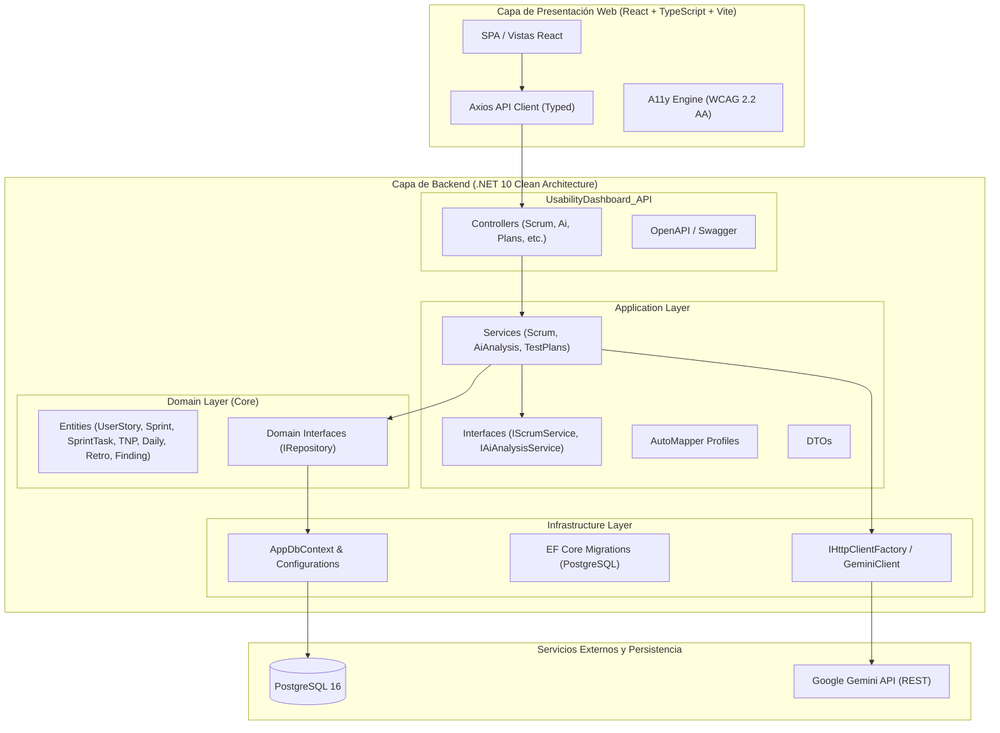
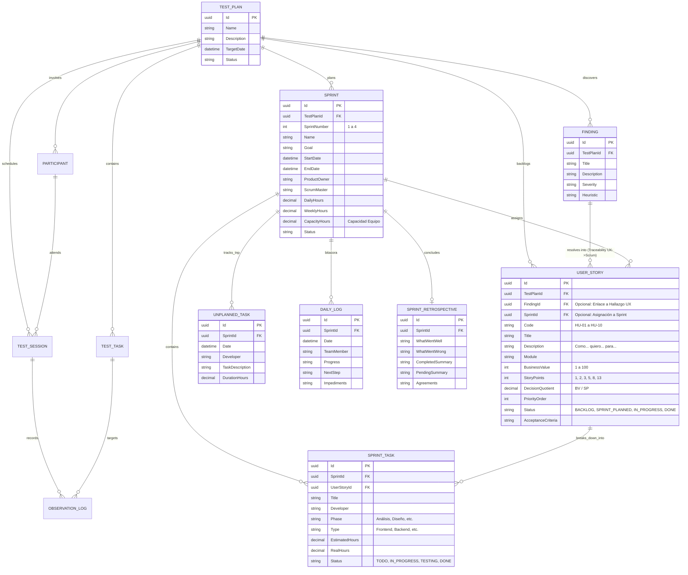
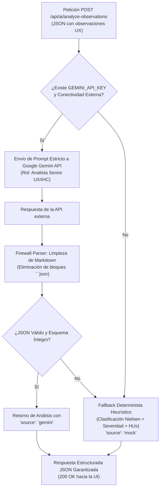

# Especificación de Arquitectura de Software y Modelo de Datos

**Universidad Técnica de Ambato**  
**Facultad de Ingeniería en Sistemas, Electrónica e Industrial**  
**Carrera de Software — Cátedra de Interacción Hombre-Computador (Nivel 5-A)**  
**Docente:** Ing. José Caiza, Mg.  
**Fecha:** Noviembre 2026 | **Versión:** 2.0  

---

## 1. Visión General de la Arquitectura

La plataforma implementa una arquitectura desacoplada basada en los principios de **Clean Architecture (Onion Architecture)** en el backend (.NET 10) y una arquitectura de componentes modulares en el frontend (React 19 + TypeScript + Vite). La persistencia de datos se gestiona mediante **PostgreSQL** y Entity Framework Core, con soporte de ejecución contenerizada bajo Docker y Docker Compose.

---

## 2. Capas de la Solución (Clean Architecture)

### 2.1 Capa de Dominio (`Domain/`)
El núcleo de la aplicación. No tiene dependencias de librerías externas ni de bases de datos.
* **Entidades Principales**:
  * `TestPlan`, `TestTask`, `Participant`, `TestSession`, `ObservationLog`, `Finding`.
  * `UserStory`: Código (HU-01..10), Título, Módulo, BV (1-100), SP (1-13 Fibonacci), $BV/SP$ (Cociente de Decisión), Prioridad, Criterios de Aceptación, `FindingId` (clave foránea de trazabilidad UX), `SprintId`.
  * `Sprint`: SprintNumber (1-4), Nombre, Objetivo, PO, SM, Fechas, Horas diarias/semanales, Capacidad en horas, Estado.
  * `SprintTask`: Título, Desarrollador, Fase (Análisis, Diseño, etc.), Tipo, Horas Estimadas, Horas Reales, Estado (`TODO`, `IN_PROGRESS`, `TESTING`, `DONE`).
  * `UnplannedTask` (TNP): Fecha, Desarrollador, Descripción, Horas de Desvío.
  * `DailyLog`: Fecha, Miembro, Qué hizo, Qué hará, Impedimentos.
  * `SprintRetrospective`: Qué salió bien, Qué salió mal, Acuerdos, Resumen de pendientes.
* **Interfaces de Dominio**: `IRepository<T>`.

### 2.2 Capa de Aplicación (`Application/`)
Orquesta los casos de uso, lógica de negocio y transformación de datos:
* **`ScrumService`**:
  * Cálculo dinámico del Cociente de Decisión: $\text{Cociente} = \frac{BV}{SP}$.
  * Ordenamiento automático del Backlog por cociente descendente.
  * Validación de capacidad de sprint (alerta si la suma de horas estimadas supera la capacidad del equipo).
  * Generación y exportación de la **Matriz de Planificación en Excel/CSV con BOM UTF-8** para compatibilidad con Microsoft Excel.
  * Inicialización / Semilla de las 10 historias (HU-01 a HU-10) y los 4 Sprints estándar.
* **`AiAnalysisService`**:
  * Procesamiento de observaciones UX.
  * Extracción y refinamiento de historias de usuario sugeridas.
  * Mecanismo de contingencia determinista (*deterministic fallback*) con bandera `"source": "mock"`.
* **Inyección de Dependencias**: Uso estricto de `IHttpClientFactory` para evitar el agotamiento de sockets (*socket exhaustion*).

### 2.3 Capa de Infraestructura (`Infrastructure/`)
Implementa los accesos a datos y adaptadores externos:
* `AppDbContext`: Configuración Fluent API (`UserStoryConfiguration`, `SprintConfiguration`, etc.) asegurando índices, longitudes máximas y restricciones de clave foránea en cascada o eliminación controlada.
* Migraciones de EF Core compiladas para PostgreSQL.

### 2.4 Capa de Presentación Web API (`UsabilityDashboard_API/`)
Expone la API RESTful bajo convenciones OpenAPI/Swagger:
* `ScrumController`: Endpoints de Backlog, Sprints, Tareas Kanban, TNP, Daily, Retrospectivas, Exportación y Semilla.
* `AiController`: Endpoints de análisis heurístico inteligente.
* Middleware global de manejo de excepciones y validación.

---

## 3. Modelo Entidad-Relación Relacional

A continuación se presenta el diagrama formal de la base de datos con la trazabilidad completa entre la evaluación de usabilidad y el ciclo SCRUM:

---

## 4. Arquitectura del Pipeline de Inteligencia Artificial

Para garantizar resiliencia en entornos académicos y de producción, el motor de IA de Observaciones opera bajo una arquitectura de **doble barrera defensiva**:

### Prompt del Analista Senior UX / IHC
El prompt del sistema instruye al modelo para actuar como especialista en interacción humano-computador, exigiendo:
1. Clasificación estricta en las 10 Heurísticas de Nielsen y pautas WCAG 2.2 AA.
2. Identificación de componentes de interfaz afectados.
3. Formulación de Historias de Usuario bajo el estándar ágil: *"Como [rol], quiero [funcionalidad] para [beneficio]"*.
4. Redacción de Criterios de Aceptación verificables en formato de checklist.
5. Emisión de salida exclusivamente en formato JSON plano sin texto conversacional.

---

## 5. Inventario de Endpoints RESTful Clave

| Método | Endpoint | Descripción |
|---|---|---|
| `GET` | `/api/scrum/backlog/{planId}` | Obtiene las historias del Product Backlog ordenadas por prioridad. |
| `POST` | `/api/scrum/backlog` | Crea una nueva historia de usuario calculando $BV/SP$. |
| `PUT` | `/api/scrum/backlog/{id}` | Actualiza una historia de usuario y recalcula $BV/SP$. |
| `DELETE` | `/api/scrum/backlog/{id}` | Elimina una historia del backlog. |
| `POST` | `/api/scrum/backlog/reorder` | Actualiza el orden secuencial de prioridades. |
| `POST` | `/api/scrum/backlog/seed/{planId}` | Siembra automática de las HU-01 a HU-10 de la matriz original. |
| `GET` | `/api/scrum/sprints/{planId}` | Lista los Sprints con métricas de capacidad y horas. |
| `GET` | `/api/scrum/sprints/{id}/detail` | Detalle del Sprint con sus historias, tareas Kanban, TNP, Daily y Retro. |
| `POST` | `/api/scrum/tasks` | Crea una tarea en el tablero Kanban. |
| `PUT` | `/api/scrum/tasks/{id}/status` | Actualiza la columna del tablero Kanban (`TODO`, `IN_PROGRESS`, etc.). |
| `POST` | `/api/scrum/tnp` | Registra una Tarea No Planificada (TNP). |
| `POST` | `/api/scrum/daily` | Registra una entrada en la bitácora Daily Scrum. |
| `POST` | `/api/scrum/retrospective` | Guarda o actualiza la Retrospectiva del Sprint. |
| `GET` | `/api/scrum/sprints/{id}/export-matrix` | Descarga la matriz de planificación en CSV/Excel con BOM UTF-8. |
| `POST` | `/api/ai/analyze-observations` | Analiza observaciones mediante IA y sugiere historias de usuario. |
