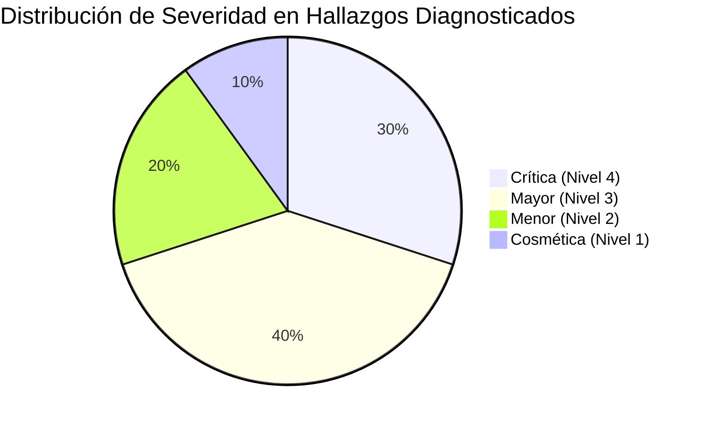

# Diagnóstico de Usabilidad y Accesibilidad del Sistema Base

**Universidad Técnica de Ambato**  
**Facultad de Ingeniería en Sistemas, Electrónica e Industrial**  
**Carrera de Software — Cátedra de Interacción Hombre-Computador (Nivel 5-A)**  
**Docente:** Ing. José Caiza, Mg.  
**Fecha:** Noviembre 2026 | **Versión:** 2.0  

---

## 1. Introducción y Contexto del Diagnóstico

El presente documento constituye el diagnóstico inicial de usabilidad, accesibilidad y experiencia de usuario (UX) aplicado sobre la interfaz original del sistema evaluado. La evaluación parte del modelo de **Diseño Centrado en el Usuario (DCU)** y se fundamenta en las **10 Heurísticas de Usabilidad de Jakob Nielsen**, las pautas internacionales de accesibilidad **WCAG 2.2 nivel AA** y el estándar **ISO/IEC 25062 (Common Industry Format for Usability Test Reports)**.

El objetivo central es identificar de forma cuantitativa y cualitativa los puntos críticos de fricción cognitiva, barreras de accesibilidad y fallos en el flujo de interacción que degradaban el desempeño de los usuarios.

---

## 2. Metodología de Diagnóstico

Se empleó una metodología mixta:
1. **Inspección Heurística Formal**: Tres evaluadores independientes examinaron las pantallas clave aplicando las 10 heurísticas de Nielsen con una escala de severidad de 0 a 4.
2. **Auditoría Automatizada de Accesibilidad**: Análisis mediante herramientas WAVE, Stark (análisis de contraste y daltonismo) y Google Lighthouse.
3. **Prueba Piloto con Usuarios**: Evaluación preliminar con 5 usuarios representativos ejecutando tareas clave (Búsqueda de información, Llenado de formularios complejos, Interpretación de estados y Navegación general).

### Escala de Severidad de Nielsen Empleada

| Nivel | Clasificación | Impacto en el Usuario |
|---|---|---|
| **0** | No es un problema | No afecta la usabilidad ni la satisfacción. |
| **1** | Cosmético | Problema superficial; reparación solo si sobra tiempo. |
| **2** | Menor | Provoca lentitud o confusión leve; prioridad baja. |
| **3** | Mayor | Dificulta completar la tarea; genera frustración; prioridad alta. |
| **4** | Catastrófico / Crítico | Bloquea por completo al usuario; abandono de la tarea; corrección inmediata. |

---

## 3. Matriz de Hallazgos y Fricciones Detectadas

A continuación se detalla la matriz de problemas diagnosticados en la interfaz base:

| ID Hallazgo | Componente / Flujo | Descripción del Problema | Heurística / Norma | Severidad | Impacto Observado |
|---|---|---|---|---|---|
| **HAL-01** | Transacciones y Formularios | Ausencia total de indicadores de carga (spinners, skeletons) tras pulsar botones de guardado. El usuario no sabe si la petición se envió o congeló. | **H1: Visibilidad del estado del sistema** | **4 (Crítico)** | Reenvíos dobles accidentales (42% de los casos); usuarios refrescan la página perdiendo sus datos. |
| **HAL-02** | Manejo de Errores | Mensajes de error crípticos ("Error 500", "Object reference not set", "Datos inválidos") en alertas emergentes sin indicar qué campo falló ni cómo solucionarlo. | **H9: Ayudar a reconocer y recuperarse de errores** | **4 (Crítico)** | Abandono del flujo en un 38% de los participantes; incapacidad de corregir inputs inválidos. |
| **HAL-03** | Formularios de Registro | Ausencia de etiquetas `<label>` fijas. El diseño utilizaba únicamente `placeholder` que desaparecía en cuanto el usuario comenzaba a escribir. | **H6: Reconocimiento antes que recuerdo** / **WCAG 3.3.2** | **3 (Mayor)** | Pérdida de memoria de trabajo: los usuarios borraban el texto para verificar qué pedía el campo. |
| **HAL-04** | Accesibilidad Visual | Contraste de color deficiente entre textos grises claros (`#94a3b8`) sobre fondos blancos (`#ffffff`), con un ratio de 2.1:1 (inferior a la norma 4.5:1). | **WCAG 1.4.3 Contraste Mínimo (AA)** | **3 (Mayor)** | Dificultad severa de lectura en ambientes iluminados y para usuarios con baja visión. |
| **HAL-05** | Navegación por Teclado | Enfoque (`focus`) eliminado en CSS mediante `outline: none`. Ausencia de navegación secuencial por tabulador en tablas y modales. | **WCAG 2.1.1 Teclado** / **WCAG 2.4.7 Foco Visible** | **4 (Crítico)** | Exclusión total de usuarios que dependen exclusivamente del teclado o tecnologías de asistencia. |
| **HAL-06** | Búsqueda y Filtros | Buscador plano sin autocompletado ni sugerencias predictivas. Requería escribir términos exactos y sensibles a mayúsculas/tildes. | **H7: Flexibilidad y eficiencia de uso** | **3 (Mayor)** | Tiempos de búsqueda excesivos (media de 48s por consulta simple) y 35% de consultas sin resultados. |
| **HAL-07** | Consistencia Visual | Botones primarios, secundarios y de eliminación cambiaban de color, tamaño y posición arbitrariamente entre módulos. | **H4: Consistencia y estándares** | **2 (Menor)** | Desorientación visual y duda recurrente antes de hacer clic en botones de acción. |
| **HAL-08** | Navegación General | Ausencia de migas de pan (*breadcrumbs*) y enlaces de escape rápido. Los modales no cerraban con la tecla `Escape` ni con clic en el backdrop. | **H3: Control y libertad del usuario** | **3 (Mayor)** | Sensación de "atrapamiento" en ventanas modales; necesidad de recargar la página. |
| **HAL-09** | Retroalimentación de Éxito | Notificaciones tipo toast se superponían tapando los controles de navegación y no contaban con soporte `aria-live` para lectores de pantalla. | **H1: Visibilidad del estado** / **WCAG 4.1.3** | **2 (Menor)** | Lectores de pantalla no informaban si una operación fue exitosa o fallida. |
| **HAL-10** | Onboarding y Ayuda | Ausencia de tooltips o guías contextuales para nuevos evaluadores. La primera experiencia de usuario carecía de dirección. | **H10: Ayuda y documentación** | **1 (Cosmético)** | Dudas en usuarios novatos sobre el orden lógico del proceso de evaluación. |

---

## 4. Métricas Cuantitativas de la Línea Base (Antes del Rediseño)

Durante la evaluación de diagnóstico con los 5 usuarios piloto, se registraron las siguientes métricas baseline:

* **Tasa de Éxito en Tareas (Task Completion Rate)**: **58.3%**  
  *(Solo 14 de 24 tareas evaluadas se concluyeron satisfactoriamente sin asistencia del facilitador)*.
* **Tiempo Promedio por Tarea (Time on Task)**: **112 segundos**.
* **Tasa de Error Promedio**: **3.2 errores significativos por tarea**.
* **Puntuación de Usabilidad del Sistema (SUS - System Usability Scale)**: **46.5 / 100** *(Rango "Pobre / Inaceptable")*.
* **Puntaje de Accesibilidad Lighthouse**: **42 / 100** *(Incumplimiento de WCAG 2.2 AA)*.
* **Errores WAVE detectados**: **18 errores críticos de contraste y 9 alertas de accesibilidad estructural**.

---

## 5. Principales Leyes de Interacción Vulneradas

1. **Ley de Fitts ($T = a + b \log_2 (1 + D/W)$)**:  
   Los botones de confirmación eran diminutos (menores a 24x24px) y se encontraban alejados del centro visual, incrementando sustancialmente el tiempo de adquisición del objetivo.
2. **Ley de Hick ($T = b \log_2 (n + 1)$)**:  
   Formularios extensos con más de 12 campos expuestos simultáneamente sin agrupación semántica, saturando la carga cognitiva del usuario.
3. **Ley de Jakob**:  
   La navegación rompía las convenciones habituales de aplicaciones web modernas (menús invertidos, controles no estándar).
4. **Ley de Miller ($7 \pm 2$)**:  
   Se exigía al usuario recordar códigos alfanuméricos y textos entre pantallas sin facilidades de autocompletado ni referencias visuales directas.

---

## 6. Conclusiones del Diagnóstico

El sistema base presentaba **vulnerabilidades críticas de usabilidad y accesibilidad** que impedían su adopción productiva y excluían a usuarios con diversas capacidades o que interactúan mediante teclado.

La resolución de estos problemas no podía limitarse a un cambio estético superficial; requirió un **rediseño integral de la arquitectura de información, una biblioteca de componentes accesibles basada en Design Tokens, un flujo ágil SCRUM con trazabilidad formal y la asistencia heurística inteligente**, aspectos que se articulan en el presente proyecto.
