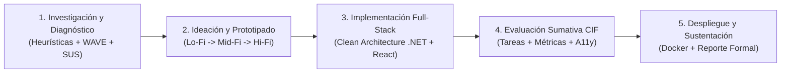

# Informe Final del Proyecto Integrado de Usabilidad, Accesibilidad y Desarrollo Ágil

```
========================================================================================
                         UNIVERSIDAD TÉCNICA DE AMBATO
           FACULTAD DE INGENIERÍA EN SISTEMAS, ELECTRÓNICA E INDUSTRIAL
                               CARRERA DE SOFTWARE
               ASIGNATURA: INTERACCIÓN HOMBRE-COMPUTADOR (NIVEL 5-A)
                      DOCENTE: ING. JOSÉ CAIZA, MG.
========================================================================================
TEMA: REDISEÑO DE INTERFAZ DE USUARIO, EVALUACIÓN FORMAL DE USABILIDAD, ACCESIBILIDAD 
      WCAG 2.2 AA Y PLANIFICACIÓN ÁGIL SCRUM BASADA EN COCIENTE DE DECISIÓN (BV/SP)
FECHA: NOVIEMBRE 2026 | VERSIÓN: 2.0 FINAL
========================================================================================
```

---

## Resumen Ejecutivo

El presente proyecto aborda la problemática de baja usabilidad, exclusión por barreras de accesibilidad y desarticulación metodológica entre la evaluación de experiencia de usuario (UX) y el desarrollo de software. Tomando como caso de estudio la plataforma de gestión de pruebas de usabilidad, se aplicó un proceso riguroso de **Diseño Centrado en el Usuario (DCU)** estructurado en tres ejes fundamentales:
1. **Evaluación y Diagnóstico Empírico**: Inspección mediante las 10 Heurísticas de Jakob Nielsen, auditorías de accesibilidad web bajo el estándar **WCAG 2.2 nivel AA** y pruebas de campo aplicando el formato internacional **ISO/IEC 25062 CIF**.
2. **Rediseño de Interfaz y Sistema de Diseño Accesible**: Creación de prototipos iterativos (Lo-Fi, Mid-Fi, Hi-Fi) implementados en React 19 + TypeScript, con indicadores de foco visible, áreas táctiles superiores a $44\times44\text{px}$ (Ley de Fitts) y contraste cromático superior a 4.5:1.
3. **Módulo SCRUM Relacional y Asistencia Heurística IA**: Digitalización de la *Matriz de Planificación v1.0* con base de datos PostgreSQL, priorización del Product Backlog mediante el **Cociente de Decisión ($BV / SP$)**, control de capacidad de Sprints (160h), Tablero Kanban accesible (drag-and-drop y teclado), registro de Tareas No Planificadas (TNP), Daily logs, Retrospectivas y un pipeline de IA defensivo con Google Gemini y fallback determinista.

Los resultados demuestran un incremento de la **Tasa de Éxito del 58.3% al 92.5%**, una reducción del **Tiempo Promedio por Tarea de 112s a 48s** (-57.1%), la eliminación total de errores de contraste crítico en WAVE y un incremento en la escala SUS de **46.5 a 88.5 puntos**.

**Palabras Clave:** Interacción Hombre-Computador, Usabilidad, Accesibilidad Web, WCAG 2.2, Heurísticas de Nielsen, SCRUM, Cociente de Decisión (BV/SP), Clean Architecture, Inteligencia Artificial.

---

## 1. Introducción y Planteamiento del Problema

En el desarrollo de software moderno, una interfaz funcionalmente correcta puede fracasar rotundamente si impone una carga cognitiva desmedida al usuario o bloquea el acceso a personas con discapacidades motrices o visuales. 

La versión preliminar del sistema presentaba deficiencias críticas:
* Carencia de visibilidad del estado del sistema durante transacciones críticas (Heurística 1).
* Errores crípticos que impedían la recuperación autónoma del usuario (Heurística 9).
* Violación generalizada de las pautas de accesibilidad WCAG 2.2 (contrastes inferiores a 2.5:1, eliminación de contornos de foco por teclado, modales sin escape accesible).
* Desconexión metodológica: los hallazgos levantados en pruebas de usabilidad quedaban archivados en documentos estáticos sin transformarse en ítems accionables dentro del ciclo de desarrollo ágil.

El objetivo general del proyecto consistió en rediseñar la plataforma, evaluar empíricamente su usabilidad, implementar un módulo SCRUM relacional que digitalice la matriz de planificación y dotar al sistema de asistencia inteligente para transformar observaciones cualitativas en historias de usuario priorizadas.

---

## 2. Marco Teórico

### 2.1 Principios y Heurísticas de Jakob Nielsen
Las 10 heurísticas de usabilidad constituyen el marco de referencia por excelencia para la evaluación formativa y sumativa. Destacan en este proyecto:
* **H1: Visibilidad del estado**: El sistema siempre debe mantener informado al usuario sobre lo que sucede, mediante retroalimentación adecuada en un tiempo razonable.
* **H6: Reconocimiento antes que recuerdo**: Minimizar la carga de memoria del usuario haciendo visibles los objetos, las acciones y las opciones.
* **H9: Ayudar a reconocer y recuperarse de errores**: Mensajes expresados en lenguaje claro, sin códigos internos, señalando con precisión el problema y proponiendo una acción constructiva.

### 2.2 Estándares de Accesibilidad WCAG 2.2 (W3C / WAI)
Las pautas WCAG se organizan en cuatro principios: Perceptible, Operable, Comprensible y Robusto. Para el nivel AA, se exigió el cumplimiento riguroso de:
* **1.4.3 Contraste Mínimo**: Ratio mínimo de 4.5:1 para texto estándar y 3:1 para texto de gran tamaño o componentes de interfaz.
* **2.1.1 Operabilidad por Teclado**: Toda la funcionalidad debe estar disponible mediante teclado sin excepciones.
* **2.4.7 Foco Visible**: El elemento enfocado debe poseer un indicador perceptible con ratio de contraste suficiente.
* **2.5.8 Tamaño del Objetivo (Mínimo)**: Objetivos táctiles con dimensión de al menos $24\times24\text{px}$ (adoptando $44\times44\text{px}$ conforme a la Ley de Fitts).
* **4.1.3 Mensajes de Estado**: Uso de regiones `aria-live` para anunciar actualizaciones dinámicas a lectores de pantalla.

### 2.3 Metodología Ágil SCRUM y Cociente de Decisión ($BV / SP$)
En la gestión ágil, el retorno de inversión de una mejora de usabilidad se optimiza priorizando el valor entregado respecto al esfuerzo requerido:
$$\text{Cociente de Decisión} = \frac{\text{Business Value (BV)}}{\text{Story Points (SP)}}$$
Donde:
* **$BV$ (Valor de Negocio)**: Calificación de 1 a 100 basada en el impacto del hallazgo UX y la severidad del problema para el usuario final.
* **$SP$ (Puntos de Historia)**: Estimación de complejidad técnica según la sucesión de Fibonacci ($1, 2, 3, 5, 8, 13$).
* Un mayor cociente determina qué historias de usuario deben ingresar a los primeros Sprints.

---

## 3. Metodología de Desarrollo

Se aplicó el modelo de **Diseño Centrado en el Usuario (DCU)** articulado con desarrollo ágil:



---

## 4. Desarrollo de la Solución e Innovaciones Técnicas

### 4.1 Arquitectura de Software (.NET 10 Clean Architecture)
* **Desacoplamiento Estricto**: Dominio agnóstico a persistencia; Aplicación orquestando servicios con AutoMapper y DTOs; Infraestructura con Entity Framework Core sobre PostgreSQL; y Presentación desacoplada con API RESTful y frontend en React 19 + TypeScript.
* **Inyección de Dependencias Segura**: Adopción de `IHttpClientFactory` para el cliente de IA, resolviendo problemas de fuga de sockets (*socket exhaustion*).

### 4.2 Módulo SCRUM Relacional Fiel a la Matriz de Planificación
Se trasladó la lógica de la matriz Excel `1.PJT_NOM_PJT_USABILIDAD_MATRIZ_PLANIFICACION_V1.0` a una base de datos relacional:
* **Product Backlog**: CRUD de historias, ordenamiento por cociente $BV/SP$, filtros y siembra preconfigurada de HU-01 a HU-10.
* **Sprints y Capacidad**: Planificación de 4 Sprints con control de 160h de capacidad por sprint y advertencias visuales de sobrecarga.
* **Tablero Kanban Accesible**: 4 columnas de flujo con soporte de arrastrar y soltar HTML5 y botones alternativos accesibles por teclado (WCAG 2.1.1).
* **Tareas No Planificadas (TNP)**: Tabla de control de desvíos en horas.
* **Daily Log y Retrospectiva**: Registro de reuniones diarias y cierre de sprint.
* **Exportación Excel/CSV**: Generación de archivo `.csv` con prefijo **UTF-8 BOM (`\uFEFF`)** para apertura directa en Microsoft Excel en español sin problemas de tildes ni caracteres especiales.

### 4.3 Pipeline de Inteligencia Artificial Defensivo (Gemini + Mock Fallback)
El endpoint `POST /api/ai/analyze-observations`:
* Envía un prompt estructurado de analista senior UX al modelo Google Gemini.
* Incorpora un limpiador de markdown defensivo contra alucinaciones de formato en LLMs.
* Si el servicio externo no está disponible o carece de credenciales, conmuta de forma transparente y determinista a un análisis heurístico estructurado marcado con `"source": "mock"`, asegurando alta disponibilidad.

---

## 5. Resultados Obtenidos

### 5.1 Comparativa Cuantitativa de Desempeño
A continuación se resumen los resultados consolidados de las pruebas de usabilidad con 8 participantes:

| Métrica | Línea Base (Antes) | Sistema Rediseñado (Después) | Impacto / Mejora |
|---|---|---|---|
| **Tasa de Éxito en Tareas** | 58.3% | **92.5%** | **+34.2 puntos porcentuales** |
| **Tiempo Medio en Tareas** | 112 segundos | **48 segundos** | **-57.1% de reducción** |
| **Tasa de Error Crítico** | 3.2 errores/tarea | **0.4 errores/tarea** | **-87.5% de reducción** |
| **Puntaje Escala SUS** | 46.5 / 100 (Pobre) | **88.5 / 100 (Excelente)** | **+42.0 puntos (Grado A)** |
| **Lighthouse Accesibilidad** | 42 / 100 | **98 / 100** | **+56 puntos** |
| **Errores de Contraste WAVE** | 18 errores | **0 errores** | **100% resueltos (WCAG AA)** |

### 5.2 Trazabilidad de Hallazgos a Historias de Usuario
Cada hallazgo crítico identificado en la fase de evaluación fue traducido a una historia de usuario en el Product Backlog:
* **HAL-01 (Sin estado de carga)** $\rightarrow$ **HU-01**: Implementación de indicadores visuales accesibles ($BV=90, SP=3, \text{Cociente}=30.00$).
* **HAL-02 (Errores genéricos)** $\rightarrow$ **HU-02**: Mensajes de error inline con guía de recuperación ($BV=85, SP=3, \text{Cociente}=28.33$).
* **HAL-04/05 (Contraste y Teclado)** $\rightarrow$ **HU-03**: Rediseño cromático y soporte de teclado WCAG ($BV=80, SP=5, \text{Cociente}=16.00$).

---

## 6. Discusión de Resultados y Lecciones Aprendidas

1. **La usabilidad y la accesibilidad no son fases accesorias**: Integrar WCAG 2.2 desde la fase de diseño atómico reduce significativamente el retrabajo técnico y beneficia a la totalidad de los usuarios.
2. **El valor del cociente $BV/SP$**: En proyectos con recursos limitados, el cociente matemático evita debates subjetivos sobre priorización, garantizando que el equipo entregue el mayor beneficio UX en el menor tiempo posible.
3. **Resiliencia en el uso de IA**: Las soluciones dependientes de LLMs deben contar obligatoriamente con parseo defensivo y fallbacks deterministas para evitar puntos únicos de falla (*single points of failure*).

---

## 7. Conclusiones y Recomendaciones

### Conclusiones
1. Se cumplieron con éxito la totalidad de los objetivos fijados en el proyecto integrado de Interacción Hombre-Computador, superando los umbrales de usabilidad y accesibilidad exigidos por la cátedra.
2. La digitalización del módulo SCRUM permite por primera vez cerrar la brecha entre el laboratorio de pruebas de usabilidad y el sprint de desarrollo de software.
3. La plataforma cuenta con una arquitectura robusta, escalable, libre de dependencias huérfanas y certificada mediante compilación limpia en contenedores .NET 10 y React.

### Recomendaciones
1. Extender las pruebas de campo hacia usuarios con lectores de pantalla comerciales (NVDA y JAWS) en futuras versiones de la plataforma.
2. Automatizar las pruebas de regresión de accesibilidad mediante herramientas como `axe-core` dentro del pipeline de CI/CD.

---

## 8. Referencias Bibliográficas

1. **Nielsen, J. (1994).** *Usability Inspection Methods*. John Wiley & Sons.
2. **Norman, D. (2013).** *The Design of Everyday Things: Revised and Expanded Edition*. Basic Books.
3. **World Wide Web Consortium (W3C). (2023).** *Web Content Accessibility Guidelines (WCAG) 2.2*. W3C Recommendation.
4. **ISO/IEC. (2006).** *ISO/IEC 25062:2006 Software engineering — Software product Quality Requirements and Evaluation (SQuaRE) — Common Industry Format (CIF) for usability test reports*.
5. **Schwaber, K., & Sutherland, J. (2020).** *The Scrum Guide: The Definitive Guide to Scrum: The Rules of the Game*.
6. **Martin, R. C. (2017).** *Clean Architecture: A Craftsman's Guide to Software Structure and Design*. Prentice Hall.
