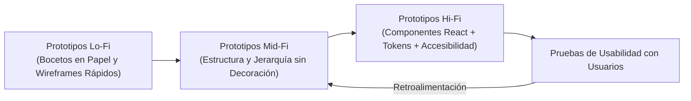
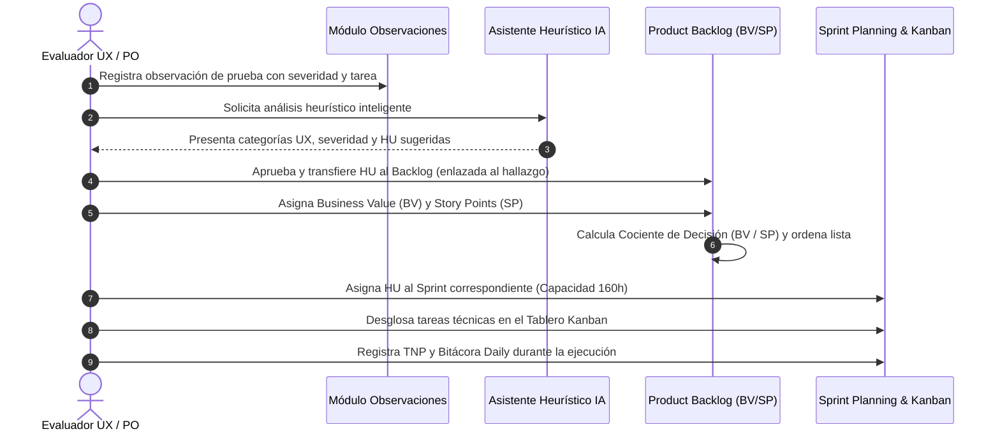

# Prototipos, Flujos de Usuario y Sistema de Diseño (Design System)

**Universidad Técnica de Ambato**  
**Facultad de Ingeniería en Sistemas, Electrónica e Industrial**  
**Carrera de Software — Cátedra de Interacción Hombre-Computador (Nivel 5-A)**  
**Docente:** Ing. José Caiza, Mg.  
**Fecha:** Noviembre 2026 | **Versión:** 2.0  

---

## 1. Enfoque de Prototipado Iterativo

El diseño de la plataforma siguió un proceso evolutivo en tres niveles de fidelidad:



1. **Baja Fidelidad (Lo-Fi)**: Exploración rápida de distribución espacial, disposición de la barra lateral de navegación y separación funcional entre las fases de usabilidad y el módulo de gestión ágil.
2. **Media Fidelidad (Mid-Fi)**: Definición de la jerarquía de información, flujos de modales, comportamiento del tablero Kanban con soporte de arrastre y teclado, y disposición de columnas de datos en la matriz SCRUM.
3. **Alta Fidelidad (Hi-Fi)**: Implementación viva en React + TypeScript + Vite, integrando Design Tokens semánticos, contrastes certificados por WCAG 2.2 AA y animaciones sutiles que refuerzan la visibilidad del estado (Heurística 1).

---

## 2. Flujos de Usuario (User Flows)

### 2.1 Flujo Integral: Desde la Observación UX hasta el Sprint Kanban



---

## 3. Wireframes y Especificación de Pantallas Clave

### 3.1 Pantalla: Product Backlog con Cociente de Decisión ($BV / SP$)

```
+---------------------------------------------------------------------------------------------------------+
| [Folder] Usability Test Dashboard 2.0          Plan Activo: [Evaluación General v2.0 v]  (Usuario)      |
+-------------------+-------------------------------------------------------------------------------------+
| [Dashboard]       |  [Icon] Product Backlog — Priorización por Cociente de Decisión                      |
| [Plan de Prueba]  |  Gestión centralizada del backlog ágil. Cociente = BV / SP (Mayor cociente = mayor  |
|                   |  retorno de inversión UX por unidad de esfuerzo técnico).                           |
| Fase 1 - Prep     |                                                                                     |
| Fase 2 - Ejec     |  [Buscar historia...] [Módulo: Todos v] [Estado: Todos v]  [+ Nueva Historia]       |
| Fase 3 - Cierre   |  [Reordenar por Cociente BV/SP]  [Sembrar HU-01 a HU-10 de Matriz Excel]           |
|                   |                                                                                     |
| Módulo SCRUM      |  +--------+-----------+-----------------------------------+----+----+-------+------+  |
|  * Product Backlog|  | Código | Módulo    | Historia de Usuario               | BV | SP | BV/SP | Act. |  |
|  * Plan & Kanban  |  +--------+-----------+-----------------------------------+----+----+-------+------+  |
|  * Sprint Legacy  |  | HU-01  | Feedback  | Indicador de estado y carga en TX | 90 |  3 | 30.00 | [E][D]  |
|                   |  | HU-02  | Errores   | Mensajes de error contextuales    | 85 |  3 | 28.33 | [E][D]  |
| Evaluación/Cierre |  | HU-03  | A11y      | Cumplimiento de contraste WCAG AA | 80 |  5 | 16.00 | [E][D]  |
|  * Comparativa    |  | HU-04  | Búsqueda  | Buscador predictivo con chips     | 75 |  8 |  9.38 | [E][D]  |
|  * Reporte PDF    |  +--------+-----------+-----------------------------------+----+----+-------+------+  |
|                   |  Mostrando 10 historias | Total SP: 45 | Total BV: 680 | Cociente Promedio: 15.11   |
+-------------------+-------------------------------------------------------------------------------------+
```

### 3.2 Pantalla: Planificación de Sprints y Tablero Kanban Accesible

```
+---------------------------------------------------------------------------------------------------------+
|  [Icon] Planificación de Sprints & Tablero Kanban                                [Descargar Matriz XLSX]|
|  Sprint Activo: [ Sprint 1 (Semana 1 - Fundamentos) v ]   Fechas: 15 Nov - 29 Nov 2026                  |
|  Capacidad del Equipo: [==============================........] 110h / 160h (68.75% Utilizado - Seguro)  |
|                                                                                                         |
|  [Pestañas]: [Sprint Planning]  [*Tablero Kanban*]  [TNP - No Planificadas]  [Daily Log]  [Retrospectiva]|
|                                                                                                         |
|  +--------------------+--------------------+--------------------+--------------------+                   |
|  | POR HACER (3)      | EN PROGRESO (2)    | EN PRUEBAS (1)     | HECHO (4)          |                   |
|  +--------------------+--------------------+--------------------+--------------------+                   |
|  | [HU-01]            | [HU-02]            | [HU-03]            | [HU-05]            |                   |
|  | Spinner accesible  | Mensajes inline    | Validación contraste| Documentación A11y |                   |
|  | Dev: Alex (8h)     | Dev: María (12h)   | Dev: Carlos (6h)   | Dev: Sofía (4h)    |                   |
|  | [<- Mover] [Mover->| [<- Mover] [Mover->| [<- Mover] [Mover->| [<- Mover] [Mover->|                   |
|  | [Editar] [Eliminar]| [Editar] [Eliminar]| [Editar] [Eliminar]| [Editar] [Eliminar]|                   |
|  +--------------------+--------------------+--------------------+--------------------+                   |
+---------------------------------------------------------------------------------------------------------+
```

---

## 4. Sistema de Diseño (Design System) y Design Tokens

### 4.1 Paleta de Colores Semántica y Contraste WCAG 2.2

| Token Semántico | Valor Hex | Uso en Interfaz | Ratio de Contraste vs Fondo | Cumplimiento |
|---|---|---|---|---|
| `--color-background` | `#ffffff` / `#f8fafc` | Fondos de página y paneles | N/A | Base |
| `--color-text-main` | `#0f172a` (Slate 900) | Títulos principales y texto regular | **16.1:1** | **WCAG AAA** |
| `--color-text-muted` | `#475569` (Slate 600) | Subtítulos, metadatos y descripciones | **6.5:1** | **WCAG AA** |
| `--color-primary` | `#2563eb` (Blue 600) | Botones primarios, enlaces activos | **4.6:1** | **WCAG AA** |
| `--color-success` | `#16a34a` (Green 600) | Estados "Hecho", verificaciones | **4.7:1** | **WCAG AA** |
| `--color-warning` | `#b45309` (Amber 700) | Alertas medias y avisos de carga | **4.8:1** | **WCAG AA** |
| `--color-danger` | `#dc2626` (Red 600) | Errores críticos y eliminación | **4.5:1** | **WCAG AA** |
| `--color-accent` | `#7c3aed` (Violet 600) | Distintivos de IA y características avanzadas | **5.2:1** | **WCAG AA** |

### 4.2 Escala Tipográfica
* **Fuente Principal**: `Inter, system-ui, -apple-system, BlinkMacSystemFont, "Segoe UI", Roboto, sans-serif`.
* **H1**: 1.875rem (30px) | Peso: 800 (Bold) | Interlineado: 1.25.
* **H2**: 1.35rem (21.6px) | Peso: 700 (Semi-bold) | Interlineado: 1.3.
* **H3**: 1.1rem (17.6px) | Peso: 600 (Medium) | Interlineado: 1.4.
* **Body / P**: 0.95rem (15.2px) | Peso: 400 (Regular) | Interlineado: 1.6.
* **Small / Badges**: 0.75rem (12px) | Peso: 700 (Bold) | Interlineado: 1.2.

### 4.3 Dimensiones de Objetivos Táctiles (Ley de Fitts y WCAG 2.5.8)
* Todos los elementos interactivos primarios (botones, checkboxes, selectores, items de menú) poseen un área de activación física mínima de **$44 \times 44\text{px}$** (mediante padding o tamaño explícito), garantizando facilidad motriz tanto en ratón como en pantallas táctiles o tecnologías adaptativas.

---

## 5. Accesibilidad en Componentes Interactivos

1. **Indicador de Foco Visible (WCAG 2.4.7)**:  
   Todos los elementos con interacción reciben la pseudoclase `:focus-visible` con un doble anillo contrastante: `outline: 2px solid #2563eb; outline-offset: 2px;`.
2. **Soporte Universal de Teclado (WCAG 2.1.1)**:
   - Modales: Se cierran con la tecla `Escape`, atrapan el foco (*focus trapping*) y devuelven el foco al botón disparador al cerrarse.
   - Tablero Kanban: Además del soporte nativo de arrastre y soltado de HTML5, cada tarjeta cuenta con botones explícitos `[<- Mover]` y `[Mover ->]` operables mediante `Tab` y `Enter`.
3. **Anuncio para Lectores de Pantalla (WCAG 4.1.3)**:
   - Notificaciones y procesos de análisis con IA utilizan `aria-live="polite"` y `role="status"` o `role="alert"`.
